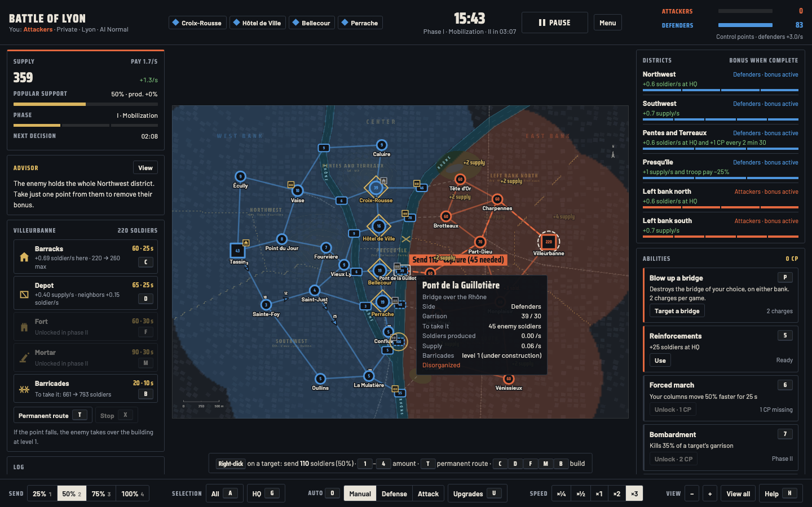
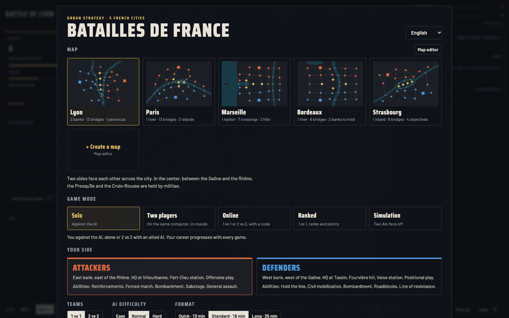
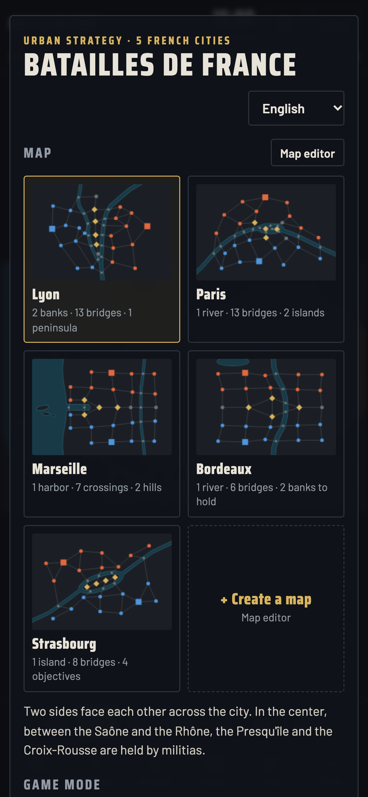

# Batailles de France

[English](README.md) · [Français](README.fr.md) · **Español**

**Un juego de estrategia en tiempo real en el navegador, sobre los mapas reales de cinco ciudades francesas.** Toma el cuartel general enemigo en Lyon, París, Marsella, Burdeos o Estrasburgo: puentes, orillas, colinas, distritos, edificios, investigaciones, habilidades, decisiones políticas e imprevistos propios de cada ciudad.

**8 idiomas**: español, inglés, francés, alemán, italiano, portugués, chino y japonés. El idioma del navegador se elige automáticamente y un menú en la pantalla de inicio permite cambiarlo. En línea, cada jugador lee los mensajes de la partida en su propio idioma.



## Modos de juego

- **Solo** contra la IA, solo o en 2 contra 2 con una IA aliada; tu carrera avanza en cada partida.
- **Dos jugadores** en el mismo ordenador, cada uno da sus órdenes por turnos.
- **En línea** con tus amigos, en 1 contra 1 o 2 contra 2, con un código de partida de 5 caracteres.
- **Clasificatoria**: emparejamiento automático, rangos de Recluta a Mariscal, clasificación de jugadores.
- **Simulación**: dos IA se enfrentan, tú miras.
- **Editor de mapas** para crear y compartir tus propios campos de batalla.

<p> </p>

---

## Jugar ya (sin conexión)

Descarga `Batailles-de-France-hors-ligne.html` en la página [Releases](https://github.com/jeremdevgit/batailles-de-france/releases/latest) y ábrelo en tu navegador. Todo funciona sin conexión: solo, dos jugadores, simulación y editor de mapas. El juego en línea y el modo clasificatorio requieren el servidor de juego (más abajo).

Para comprobar el archivo: `shasum -a 256 -c SHA256SUMS.txt --ignore-missing` (macOS / Linux) o `Get-FileHash` (Windows).

---

## Alojar el juego en línea

El servidor (`app/main.py`, FastAPI) sirve el juego, retransmite los mensajes de las partidas en línea por WebSocket y guarda la clasificación (SQLite). No calcula nada: el ordenador del anfitrión simula la partida y los invitados reciben el estado.

```sh
docker compose up -d --build
```

El servidor escucha entonces en `127.0.0.1:8000`. Pon delante un **proxy HTTPS** que transmita los WebSockets (Caddy, nginx…). Los ajustes (`FORWARDED_ALLOW_IPS`, `BDF_DONNEES`, `BDF_STATIQUE`) y la instalación sin Docker se detallan en el [README en inglés](README.md#hosting-the-game-online).

---

## Seguridad

- **Sin cuenta ni datos personales**: cada navegador recibe un token aleatorio; en la clasificación solo aparece un identificador derivado.
- **Límites en el servidor** (tamaño de los mensajes, ritmo por jugador, conexiones por dirección, partidas y jugadores); se siguen como máximo 5.000 identidades activas del ranking y las nuevas reciben HTTP 429 mientras se alcanza ese límite. También hay **consultas SQL parametrizadas** y **cabeceras de seguridad** (CSP estricta, sin iframe, `nosniff`).
- **Texto de los demás jugadores neutralizado**: no se puede inyectar HTML en la página de otro jugador. Los mensajes compartidos viajan como plantillas que cada navegador traduce localmente.
- **Imagen Docker reforzada**: usuario sin privilegios, sistema de archivos de solo lectura, sin capacidades Linux.

¿Una vulnerabilidad? Lee [SECURITY.md](SECURITY.md) antes de abrir una incidencia pública.

---

## Construir la versión sin conexión

```sh
python3 construire.py
```

Crea `dist/Batailles-de-France-hors-ligne.html` (juego, traducciones, fuentes e icono en un solo archivo) y `dist/SHA256SUMS.txt`. Basta con Python 3.8 o posterior, sin dependencias.

## Traducciones

Las traducciones están en `app/static/textes/`, un archivo por idioma, con el texto francés como clave: para corregir una traducción, basta con editar el archivo del idioma.

## Licencia

Código bajo licencia **GNU GPL v3 o posterior**: ver [LICENSE](LICENSE). Copyright © 2026 jeremdevgit. Fuentes incluidas bajo licencia SIL Open Font License 1.1 (carpeta [licences-tiers](licences-tiers/)).

## Mis otros programas

Todos libres, gratuitos y sin publicidad — [github.com/jeremdevgit](https://github.com/jeremdevgit):

| Programa | Plataforma | En resumen |
|---|---|---|
| [AutoDex](https://github.com/jeremdevgit/autodex) | Windows, macOS, Linux | Juego de colección de coches con reconocimiento de fotos en el dispositivo |
| [Boîte à outils](https://github.com/jeremdevgit/boite-a-outils) | Windows, macOS | Mantenimiento del ordenador, limpieza y búsqueda de archivos |
| [Carnet de notes](https://github.com/jeremdevgit/carnet-rust) | Windows | Cuadernos cifrados y sincronización experimental |
| [Decklight](https://github.com/jeremdevgit/decklight) | Windows, macOS, Linux | Stream Deck virtual con control USB |
| [JMeca](https://github.com/jeremdevgit/jmeca) | Windows, macOS, Linux | Seguimiento de mantenimiento de vehículos cifrado |
| [LJ Hub](https://github.com/jeremdevgit/lj-hub) | Windows, macOS, Linux | Gestor de perfiles para dispositivos Logitech |
| [Pomme](https://github.com/jeremdevgit/pomme) | Windows | Reproductor de música para Apple Music y archivos locales |
| [rJb](https://github.com/jeremdevgit/rjb) | Windows | Control de la iluminación RGB |
| [Ludothèque](https://github.com/jeremdevgit/ludotheque) | macOS | Biblioteca y lanzador de juegos |
| [Suite Libre](https://jeremdevgit.github.io/suite-libre/) | Navegador | Seis herramientas sin cuenta |
