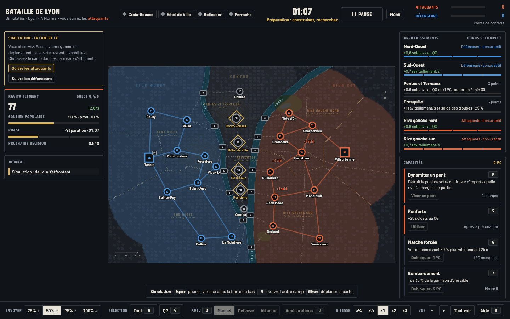
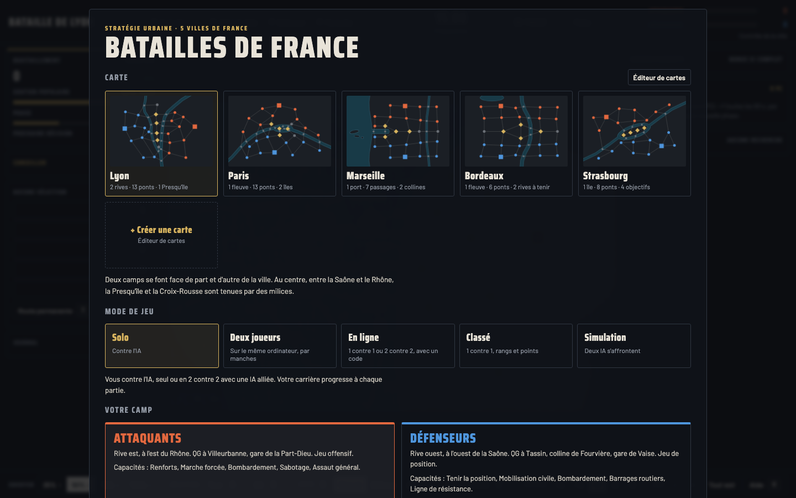
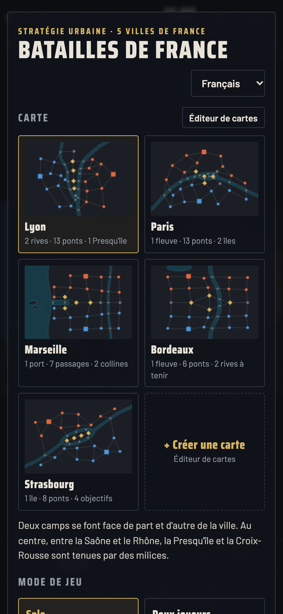

<p align="center"></p>

<h1 align="center">Batailles de France</h1>

<p align="center"><b>Un jeu de stratégie en temps réel dans le navigateur, sur les cartes de Lyon, Paris, Marseille, Bordeaux et Strasbourg.</b></p>

<p align="center"> <a href="https://github.com/jeremdevgit/batailles-de-france/releases"></a> <a href="LICENSE"></a></p>

<p align="center"><a href="README.md">English</a> · <b>Français</b> · <a href="README.es.md">Español</a> · <a href="README.de.md">Deutsch</a> · <a href="README.it.md">Italiano</a> · <a href="README.pt.md">Português</a> · <a href="README.zh.md">简体中文</a> · <a href="README.ja.md">日本語</a></p>

<p align="center"><a href="https://github.com/jeremdevgit/batailles-de-france/releases/latest"><b>⬇ Télécharger</b></a></p>



Prenez le quartier général ennemi sur les **vraies cartes de Lyon, Paris, Marseille, Bordeaux et Strasbourg** : ponts, berges, collines, quartiers, bâtiments, recherches, capacités, décisions politiques et surprises propres à chaque ville.

## En bref

| | |
|---|---|
| **Catégorie** | 🎮 Musique et jeux |
| **Plateformes** | Navigateur |
| **Interface** | 8 langues (EN, FR, ES, DE, IT, PT, ZH, JA) |
| **Prix** | Gratuit, open source, sans publicité ni télémétrie |
| **État** | Stable |
| **Licence** | [GPL-3.0-or-later](LICENSE) |

## Modes de jeu

- **Solo** contre l'IA, seul ou en 2 contre 2 avec une IA alliée ; votre carrière progresse à chaque partie.
- **Deux joueurs** sur le même ordinateur, chacun son tour.
- **En ligne** entre amis, en 1 contre 1 ou 2 contre 2, avec un code de partie de 5 caractères — chacun lit les messages dans sa langue.
- **Classé** : appariement automatique, grades de Recrue à Maréchal, classement.
- **Simulation** : regardez deux IA s'affronter.
- **Éditeur de cartes** pour créer et partager vos champs de bataille.

<p> </p>

## Comment jouer

**Tout de suite, hors ligne** — téléchargez `Batailles-de-France-hors-ligne.html` depuis la [dernière version](https://github.com/jeremdevgit/batailles-de-france/releases/latest) et ouvrez-le dans n'importe quel navigateur. Solo, deux joueurs, simulation et éditeur de cartes fonctionnent sans connexion. Vérification : `shasum -a 256 -c SHA256SUMS.txt --ignore-missing` ou `Get-FileHash`.

**En ligne et classé** demandent le serveur de jeu ci-dessous.

## Héberger le serveur

Le serveur FastAPI (`app/main.py`) sert le jeu, relaie les messages en ligne par WebSocket et tient le classement dans SQLite. C'est le navigateur de l'hôte qui simule la partie.

```sh
docker compose up -d --build     # écoute sur 127.0.0.1:8000
```

Placez devant un **proxy inverse HTTPS qui transmet les WebSockets** (Caddy : `reverse_proxy 127.0.0.1:8000` ; nginx : `proxy_http_version 1.1` et les en-têtes `Upgrade`/`Connection`).

| Variable | Rôle | Par défaut |
|---|---|---|
| `FORWARDED_ALLOW_IPS` | Proxy autorisé à transmettre l'IP réelle des joueurs. **Jamais `*`** si le port est joignable directement | `172.16.0.0/12` (Docker) |
| `BDF_DONNEES` | Dossier de la base du classement | `/donnees` |
| `BDF_STATIQUE` | Dossier des fichiers du jeu | `/app/static` |

Sans Docker : `pip install -r requirements.txt`, puis depuis `app/`, `uvicorn main:app --host 127.0.0.1 --port 8000 --proxy-headers --no-server-header` avec `BDF_STATIQUE` et `BDF_DONNEES` définis.

## Confidentialité et fair-play

- **Ni compte, ni donnée personnelle** : un jeton aléatoire par navigateur ; seule une empreinte apparaît au classement.
- Limites côté serveur sur la taille et le débit des messages, les connexions, les parties, les joueurs et les écritures au classement ; SQL paramétré ; CSP stricte et en-têtes de sécurité ; le texte des autres joueurs est neutralisé.
- Image Docker durcie (sans privilèges, lecture seule, sans capacités), polices incluses.
- Par conception, le classement se fie aux résultats envoyés par les navigateurs (contrôlés pour leur vraisemblance) et l'hôte fait foi en ligne.

## Construire

```sh
python3 construire.py     # Python 3.8+, sans dépendance → dist/Batailles-de-France-hors-ligne.html + SHA256SUMS.txt
```

Les traductions sont dans `app/static/textes/`, un fichier par langue, avec le texte français comme clé.

## Licence

GNU GPL v3 ou ultérieure — voir [LICENSE](LICENSE). Polices incluses [Barlow](https://github.com/jpt/barlow) et [Saira Condensed](https://github.com/Omnibus-Type/Saira) (OFL 1.1, [`licences-tiers/`](licences-tiers/)).

---

Une faille de sécurité ? Signalez-la en privé (voir [SECURITY.md](SECURITY.md)) plutôt que dans un ticket public.

## Mes autres logiciels libres

Tous gratuits, open source et sans publicité.

**🛠️ Système et matériel** — [Boîte à outils](https://github.com/jeremdevgit/boite-a-outils) · [rJb](https://github.com/jeremdevgit/rjb) · [LJ Hub](https://github.com/jeremdevgit/lj-hub) · [Decklight](https://github.com/jeremdevgit/decklight)

**📒 Productivité et données** — [Carnet de notes](https://github.com/jeremdevgit/carnet-rust) · [JMeca](https://github.com/jeremdevgit/jmeca) · [Suite Libre](https://jeremdevgit.github.io/suite-libre/)

**🎮 Musique et jeux** — [Pomme](https://github.com/jeremdevgit/pomme) · [Ludothèque](https://github.com/jeremdevgit/ludotheque) · [AutoDex](https://github.com/jeremdevgit/autodex)
