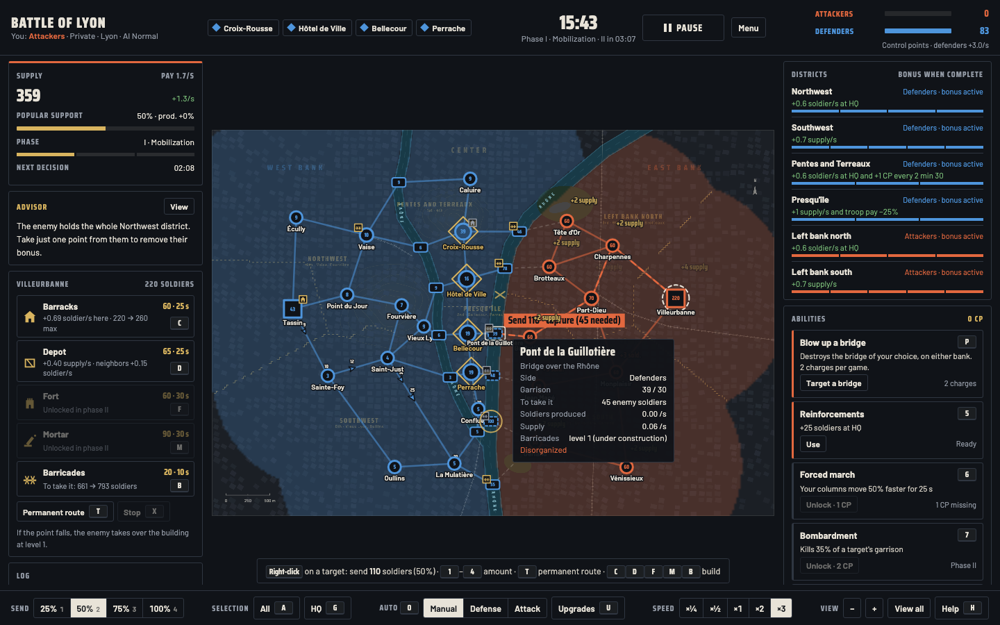

<p align="center"></p>

<h1 align="center">Batailles de France</h1>

<p align="center"><b>Strategia in tempo reale nel browser sulle mappe di Lione, Parigi, Marsiglia, Bordeaux e Strasburgo.</b></p>

<p align="center"> <a href="https://github.com/jeremdevgit/batailles-de-france/releases"></a> <a href="LICENSE"></a></p>

<p align="center"><a href="README.md">English</a> · <a href="README.fr.md">Français</a> · <a href="README.es.md">Español</a> · <a href="README.de.md">Deutsch</a> · <b>Italiano</b> · <a href="README.pt.md">Português</a> · <a href="README.zh.md">简体中文</a> · <a href="README.ja.md">日本語</a></p>

<p align="center"><a href="https://github.com/jeremdevgit/batailles-de-france/releases/latest"><b>⬇ Scarica</b></a></p>



Conquista il quartier generale nemico sulle **vere mappe di Lione, Parigi, Marsiglia, Bordeaux e Strasburgo**: ponti, argini, colline, quartieri, edifici, ricerche, abilità, decisioni politiche e sorprese tipiche di ogni città.

## In breve

| | |
|---|---|
| **Categoria** | 🎮 Musica e giochi |
| **Piattaforme** | Browser |
| **Interfaccia** | 8 lingue (EN, FR, ES, DE, IT, PT, ZH, JA) |
| **Prezzo** | Gratuito, open source, senza pubblicità né telemetria |
| **Stato** | Stabile |
| **Licenza** | [GPL-3.0-or-later](LICENSE) |

## Modalità di gioco

- **Singolo** contro l'IA, da solo o 2 contro 2 con un'IA alleata; la tua carriera cresce a ogni partita.
- **Due giocatori** sullo stesso computer, a turno.
- **Online** con gli amici, 1 contro 1 o 2 contro 2, con un codice partita di 5 caratteri: ognuno legge i messaggi nella propria lingua.
- **Classificata**: abbinamento automatico, gradi da Recluta a Maresciallo, classifica.
- **Simulazione**: guarda due IA combattere.
- **Editor di mappe** per creare e condividere i tuoi campi di battaglia.

<p> </p>

## Come giocare

**Subito, offline**: scarica `Batailles-de-France-hors-ligne.html` dalla [versione più recente](https://github.com/jeremdevgit/batailles-de-france/releases/latest) e aprilo in qualsiasi browser. Singolo, due giocatori, simulazione ed editor di mappe funzionano senza connessione. Verifica: `shasum -a 256 -c SHA256SUMS.txt --ignore-missing` o `Get-FileHash`.

**Online e classificata** richiedono il server di gioco.

## Ospitare il server

Il server FastAPI (`app/main.py`) distribuisce il gioco, inoltra i messaggi online via WebSocket e tiene la classifica in SQLite. È il browser dell'host a simulare la partita.

```sh
docker compose up -d --build     # in ascolto su 127.0.0.1:8000
```

Metti davanti un **reverse proxy HTTPS che inoltri i WebSocket** (Caddy: `reverse_proxy 127.0.0.1:8000`; nginx: `proxy_http_version 1.1` più le intestazioni `Upgrade`/`Connection`).

| Variabile | Scopo | Predefinito |
|---|---|---|
| `FORWARDED_ALLOW_IPS` | Proxy autorizzato a trasmettere l'IP reale dei giocatori. **Mai `*`** se la porta è raggiungibile direttamente | `172.16.0.0/12` (Docker) |
| `BDF_DONNEES` | Cartella del database della classifica | `/donnees` |
| `BDF_STATIQUE` | Cartella dei file del gioco | `/app/static` |

Senza Docker: `pip install -r requirements.txt`, poi da `app/` esegui `uvicorn main:app --host 127.0.0.1 --port 8000 --proxy-headers --no-server-header` con `BDF_STATIQUE` e `BDF_DONNEES` impostate.

## Privacy e fair play

- **Nessun account né dato personale**: un token casuale per browser; in classifica compare solo un hash.
- Limiti lato server su dimensione e frequenza dei messaggi, connessioni, partite, giocatori e scritture in classifica; SQL parametrizzato; CSP rigorosa e intestazioni di sicurezza; il testo degli altri giocatori viene neutralizzato.
- Immagine Docker irrobustita (senza privilegi, sola lettura, senza capability), font inclusi.
- Per scelta, la classifica si fida dei risultati inviati dai browser (controllati per plausibilità) e online l'host fa fede.

## Compilare

```sh
python3 construire.py     # Python 3.8+, senza dipendenze → dist/Batailles-de-France-hors-ligne.html + SHA256SUMS.txt
```

Le traduzioni sono in `app/static/textes/`, un file per lingua, con il testo francese come chiave.

## Licenza

GNU GPL v3 o successiva — vedi [LICENSE](LICENSE). Font inclusi [Barlow](https://github.com/jpt/barlow) e [Saira Condensed](https://github.com/Omnibus-Type/Saira) (OFL 1.1, [`licences-tiers/`](licences-tiers/)).

---

Hai trovato una vulnerabilità? Segnalala in privato (vedi [SECURITY.md](SECURITY.md)) e non in una issue pubblica.

## Altro software libero di jeremdevgit

Tutti gratuiti, open source e senza pubblicità.

**🛠️ Sistema e hardware** — [Boîte à outils](https://github.com/jeremdevgit/boite-a-outils) · [rJb](https://github.com/jeremdevgit/rjb) · [LJ Hub](https://github.com/jeremdevgit/lj-hub) · [Decklight](https://github.com/jeremdevgit/decklight)

**📒 Produttività e dati** — [Carnet de notes](https://github.com/jeremdevgit/carnet-rust) · [JMeca](https://github.com/jeremdevgit/jmeca) · [Suite Libre](https://jeremdevgit.github.io/suite-libre/)

**🎮 Musica e giochi** — [Pomme](https://github.com/jeremdevgit/pomme) · [Ludothèque](https://github.com/jeremdevgit/ludotheque) · [AutoDex](https://github.com/jeremdevgit/autodex)
