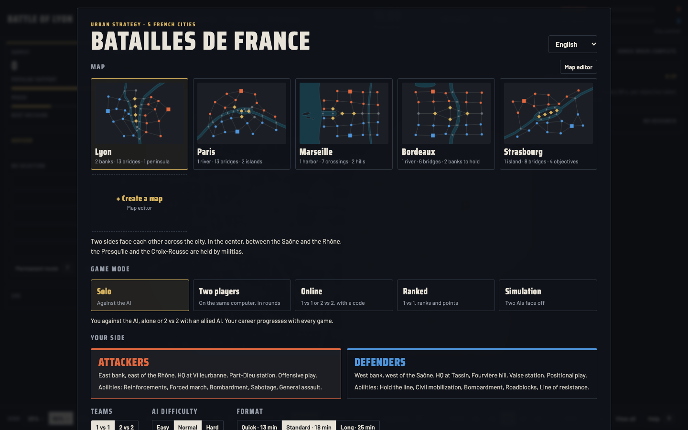
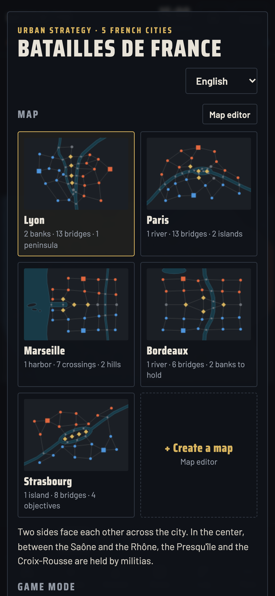

<p align="center"></p>

<h1 align="center">Batailles de France</h1>

<p align="center"><b>Real-time strategy in the browser on the maps of Lyon, Paris, Marseille, Bordeaux and Strasbourg.</b></p>

<p align="center"> <a href="https://github.com/jeremdevgit/batailles-de-france/releases"></a> <a href="LICENSE"></a></p>

<p align="center"><b>English</b> · <a href="README.fr.md">Français</a> · <a href="README.es.md">Español</a> · <a href="README.de.md">Deutsch</a> · <a href="README.it.md">Italiano</a> · <a href="README.pt.md">Português</a> · <a href="README.zh.md">简体中文</a> · <a href="README.ja.md">日本語</a></p>

<p align="center"><a href="https://github.com/jeremdevgit/batailles-de-france/releases/latest"><b>⬇ Download</b></a></p>


Take the enemy headquarters on the **real maps of Lyon, Paris, Marseille, Bordeaux and Strasbourg**: bridges, riverbanks, hills, districts, buildings, research, abilities, political decisions and city-specific surprises.

## At a glance

| | |
|---|---|
| **Category** | 🎮 Music & games |
| **Platforms** | Browser |
| **Interface** | 8 languages (EN, FR, ES, DE, IT, PT, ZH, JA) |
| **Price** | Free, open source, no ads, no telemetry |
| **Status** | Stable |
| **License** | [GPL-3.0-or-later](LICENSE) |

## Game modes

- **Solo** against the AI, alone or 2 vs 2 with an allied AI; your career grows with every game.
- **Two players** on the same computer, taking turns.
- **Online** with friends, 1 vs 1 or 2 vs 2, with a 5-character game code — each player reads messages in their own language.
- **Ranked**: matchmaking, ranks from Recruit to Marshal, leaderboard.
- **Simulation**: watch two AIs fight.
- **Map editor** to create and share your own battlefields.

<p> </p>

## How to play

**Right away, offline** — download `Batailles-de-France-hors-ligne.html` from the [latest release](https://github.com/jeremdevgit/batailles-de-france/releases/latest) and open it in any browser. Solo, two players, simulation and the map editor work without a connection. Verify with `shasum -a 256 -c SHA256SUMS.txt --ignore-missing` or `Get-FileHash`.

**Online and ranked** need the game server below.

## Host the server

The FastAPI server (`app/main.py`) serves the game, relays online messages over WebSocket and keeps the leaderboard in SQLite. The host's browser simulates the game.

```sh
docker compose up -d --build     # listens on 127.0.0.1:8000
```

Put an **HTTPS reverse proxy that forwards WebSockets** in front (Caddy: `reverse_proxy 127.0.0.1:8000`; nginx: `proxy_http_version 1.1` plus `Upgrade`/`Connection` headers).

| Variable | Purpose | Default |
|---|---|---|
| `FORWARDED_ALLOW_IPS` | Proxy allowed to pass the player's real IP. **Never `*`** if the port is reachable directly | `172.16.0.0/12` (Docker) |
| `BDF_DONNEES` | Leaderboard database folder | `/donnees` |
| `BDF_STATIQUE` | Game files folder | `/app/static` |

Without Docker: `pip install -r requirements.txt`, then from `app/` run `uvicorn main:app --host 127.0.0.1 --port 8000 --proxy-headers --no-server-header` with `BDF_STATIQUE` and `BDF_DONNEES` set.

## Privacy and fair play

- **No account, no personal data**: a random token per browser; only a hash appears on the leaderboard.
- Server limits on message size, rate, connections, games, players and leaderboard writes; parameterized SQL; strict CSP and security headers; text from other players is neutralized.
- Hardened Docker image (unprivileged, read-only, no capabilities), bundled fonts.
- By design, the leaderboard trusts results reported by browsers (checked for plausibility) and the host is authoritative in online games.

## Build from source

```sh
python3 construire.py     # Python 3.8+, no dependencies → dist/Batailles-de-France-hors-ligne.html + SHA256SUMS.txt
```

Translations live in `app/static/textes/`, one file per language, with the French text as key.

## License

GNU GPL v3 or later — see [LICENSE](LICENSE). Bundled [Barlow](https://github.com/jpt/barlow) and [Saira Condensed](https://github.com/Omnibus-Type/Saira) fonts (OFL 1.1, [`licences-tiers/`](licences-tiers/)).

---

Found a vulnerability? Please report it privately (see [SECURITY.md](SECURITY.md)) rather than in a public issue.

## More free software by jeremdevgit

All free, open source and ad-free.

**🛠️ System & hardware** — [Boîte à outils](https://github.com/jeremdevgit/boite-a-outils) · [rJb](https://github.com/jeremdevgit/rjb) · [LJ Hub](https://github.com/jeremdevgit/lj-hub) · [Decklight](https://github.com/jeremdevgit/decklight)

**📒 Productivity & data** — [Carnet de notes](https://github.com/jeremdevgit/carnet-rust) · [JMeca](https://github.com/jeremdevgit/jmeca) · [Suite Libre](https://jeremdevgit.github.io/suite-libre/)

**🎮 Music & games** — [Pomme](https://github.com/jeremdevgit/pomme) · [Ludothèque](https://github.com/jeremdevgit/ludotheque) · [AutoDex](https://github.com/jeremdevgit/autodex)
