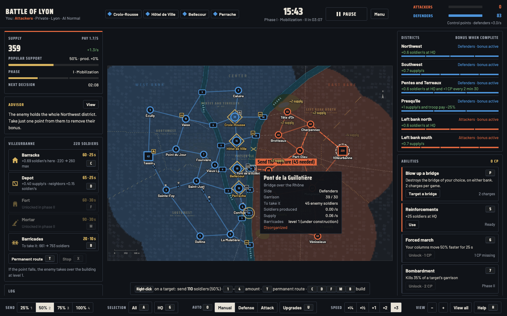
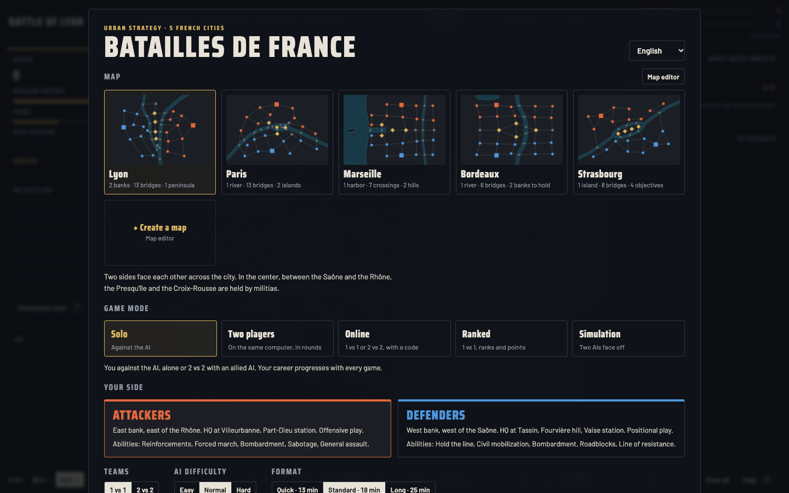
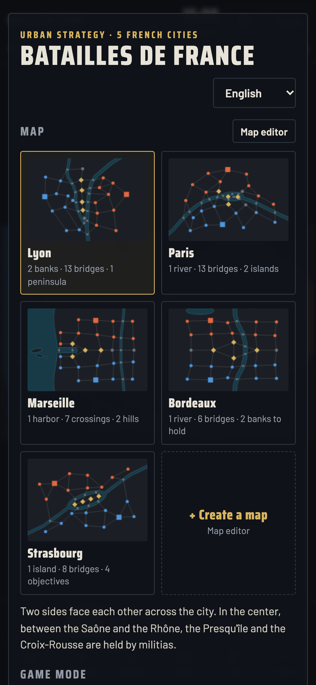
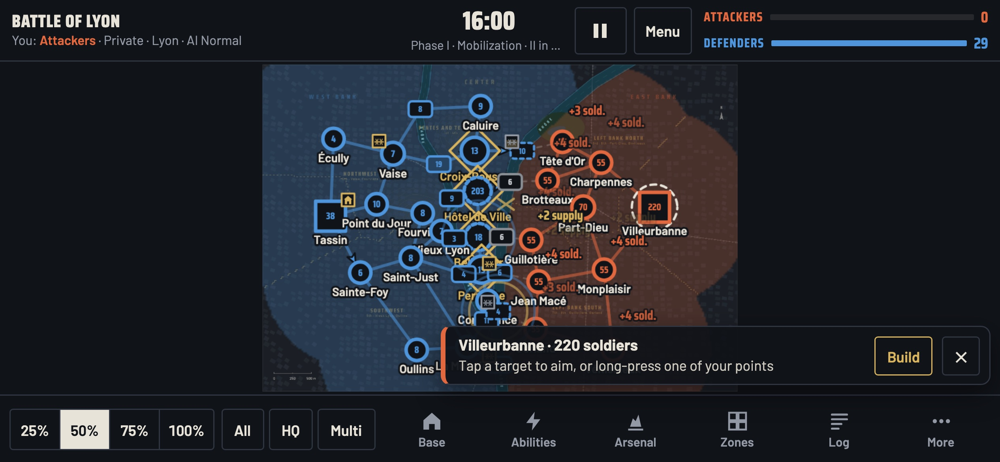

# Batailles de France

**English** · [Français](README.fr.md) · [Español](README.es.md)

**A real-time strategy game in the browser, played on the real maps of five French cities.** Take the enemy headquarters in Lyon, Paris, Marseille, Bordeaux or Strasbourg: bridges, riverbanks, hills, districts, buildings, research, abilities, political decisions and city-specific surprises.

**8 languages**: English, French, Spanish, German, Italian, Portuguese, Chinese and Japanese. The browser language is picked automatically and a menu on the home screen lets you switch. Online, each player reads the game messages in their own language.



## Game modes

- **Solo** against the AI, alone or 2 vs 2 with an allied AI; your career progresses with every game.
- **Two players** on the same computer, each giving orders in turn.
- **Online** with friends, 1 vs 1 or 2 vs 2, using a 5-character game code.
- **Ranked**: automatic matchmaking, ranks from Recruit to Marshal, player leaderboard.
- **Simulation**: two AIs fight, you watch.
- **Map editor** to create and share your own battlefields.

<p> </p>

<p></p>

---

## Play right away (offline)

Download `Batailles-de-France-hors-ligne.html` from the [Releases](https://github.com/jeremdevgit/batailles-de-france/releases/latest) page and open it in your browser. Everything works without a connection: solo, two players, simulation and map editor. Online play and ranked mode need the game server (below).

To check the file: `shasum -a 256 -c SHA256SUMS.txt --ignore-missing` (macOS / Linux) or `Get-FileHash` (Windows).

---

## Hosting the game online

The server (`app/main.py`, FastAPI) serves the game, relays online game messages over WebSocket and keeps the leaderboard (SQLite). It doesn't compute anything: the host's computer simulates the game and guests receive the state.

### With Docker (recommended)

```sh
docker compose up -d --build
```

The server then listens on `127.0.0.1:8000`. Put an **HTTPS proxy** that forwards WebSockets in front of it. Example with Caddy:

```caddy
game.example.com {
	reverse_proxy 127.0.0.1:8000
}
```

Example with nginx:

```nginx
location / {
    proxy_pass http://127.0.0.1:8000;
    proxy_http_version 1.1;
    proxy_set_header Upgrade $http_upgrade;
    proxy_set_header Connection "upgrade";
    proxy_set_header Host $host;
    proxy_set_header X-Forwarded-For $proxy_add_x_forwarded_for;
}
```

### Settings (environment variables)

| Variable | Purpose | Default |
|---|---|---|
| `FORWARDED_ALLOW_IPS` | Address or network of the proxy allowed to pass on players' real IP. **Never set it to `*`** if the server port can be reached directly: a player could spoof an address and get around the limits. | `172.16.0.0/12` in `docker-compose.yml` (proxy on the same machine, through the Docker gateway) |
| `BDF_DONNEES` | Leaderboard database folder | `/donnees` |
| `BDF_STATIQUE` | Game files folder | `/app/static` |

### Without Docker

```sh
python3 -m venv .venv && . .venv/bin/activate
pip install -r requirements.txt
cd app && BDF_STATIQUE="$PWD/static" BDF_DONNEES="$PWD/../donnees" \
  uvicorn main:app --host 127.0.0.1 --port 8000 --proxy-headers --no-server-header
```

(Create the `donnees/` folder first.)

---

## Security

- **No account, no personal data**: each browser gets a random token; only a derived identifier (hash) appears on the leaderboard.
- **Server-side limits**: message size, rate per player, connections per address, number of games and players per game, leaderboard writes per minute; at most 5,000 active writer identities are tracked, and new identities receive HTTP 429 while that bound is full.
- **Parameterized SQL queries**, inputs validated with strict patterns, API documentation disabled.
- **Security headers** sent by the server itself: strict CSP (`script-src 'self'`), no framing, `nosniff`, no referrer.
- **Text from other players neutralized** (host's map, nickname, imported map): no HTML can be injected into another player's page. Shared game messages travel as templates that each player's browser translates locally.
- **Hardened Docker image**: unprivileged user, read-only file system, no Linux capabilities, `no-new-privileges`, limited memory.
- **Bundled fonts**: no requests to third-party services.

**Known limitations** (by design, not vulnerabilities): the leaderboard relies on results reported by browsers (the server checks they are plausible: one game at a time, at most 100 points difference); in an online game, the host's computer is authoritative.

Found a vulnerability? Please read [SECURITY.md](SECURITY.md) before opening a public issue.

---

## Building the offline version

```sh
python3 construire.py
```

Creates `dist/Batailles-de-France-hors-ligne.html` (game, translations, fonts and icon in a single file, scripts allowed by their SHA-256 hash) and `dist/SHA256SUMS.txt`. Python 3.8 or later is enough, with no dependencies.

## Translations

`app/static/langue.js` picks the language (`?lang=` link, saved choice, then browser language) and translates the page once when it loads; `textes-chargeur.js` loads only the file for that language from `app/static/textes/`. The French text is the key: to fix a translation, edit the language's file.

## Repository layout

```
app/main.py              game server (FastAPI): pages, WebSocket relay, leaderboard
app/static/              the game: index.html, jeu.js, reseau.js (network client), icon, fonts
app/static/textes/       translations, one file per language
Dockerfile, docker-compose.yml, requirements.txt
construire.py            builds the offline version (dist/)
captures/                screenshots (captures/en: English interface)
licences-tiers/          font licenses
```

## License

Code under the **GNU GPL v3 or later** — see [LICENSE](LICENSE). Copyright © 2026 jeremdevgit.

Bundled fonts, under the SIL Open Font License 1.1 (folder [licences-tiers](licences-tiers/)): [Barlow](https://github.com/jpt/barlow) and [Saira Condensed](https://github.com/Omnibus-Type/Saira).

## My other software

All free, open source and ad-free — [github.com/jeremdevgit](https://github.com/jeremdevgit):

| Software | For | In short |
|---|---|---|
| [Carnet Rust](https://github.com/jeremdevgit/carnet-rust) | Windows | encrypted local notes and experimental Joplin/Nextcloud sync · [download ZIP](https://github.com/jeremdevgit/carnet-rust/releases/latest) |
| [JMeca](https://github.com/jeremdevgit/jmeca) | Windows, macOS, Linux | encrypted vehicle maintenance, client folders, service log and fuel tracking |
| [Boîte à outils](https://github.com/jeremdevgit/boite-a-outils) | Windows, macOS | maintenance, cleanup and hidden settings |
| [Pomme](https://github.com/jeremdevgit/pomme) | Windows | Apple Music and local music player |
| [rJb](https://github.com/jeremdevgit/rjb) | Windows | RGB lighting for all your devices in one app |
| [Ludothèque](https://github.com/jeremdevgit/ludotheque) | macOS | all your games in one launcher |
| [Suite Libre](https://jeremdevgit.github.io/suite-libre/) | browser | six tools with no account: QR codes, blur, photos, conversions, averages, passwords |
