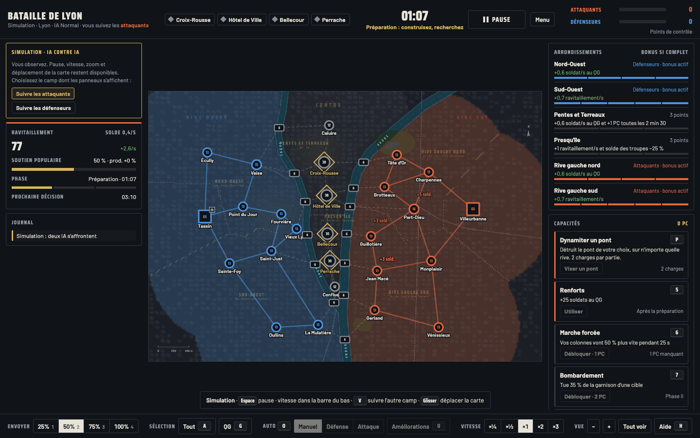
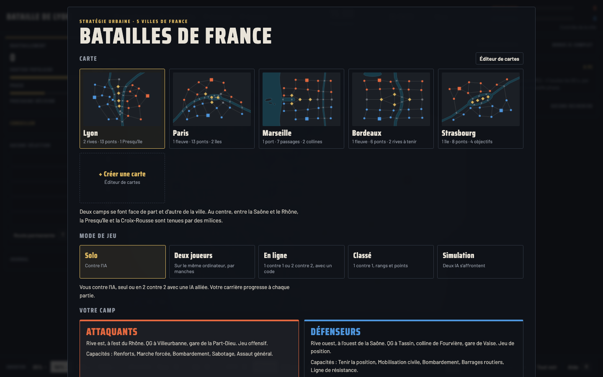
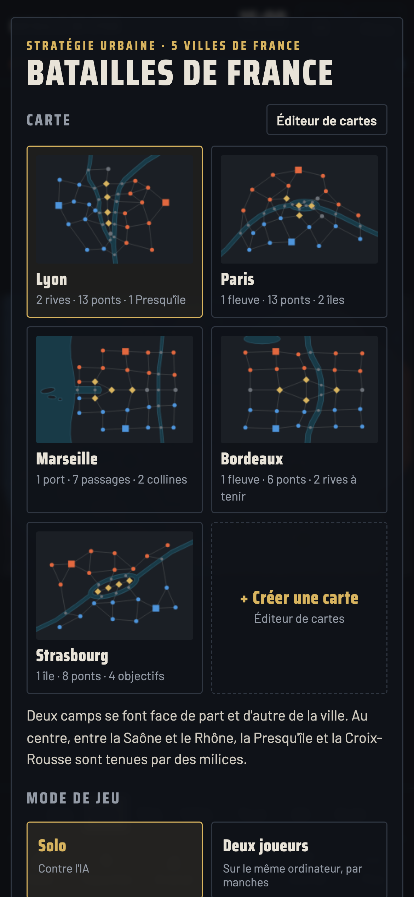
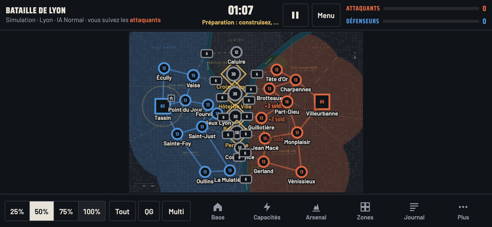

# Batailles de France

**Un jeu de stratégie en temps réel dans le navigateur, sur les vraies cartes de cinq villes françaises.** Prends le quartier général adverse à Lyon, Paris, Marseille, Bordeaux ou Strasbourg : ponts, rives, collines, arrondissements, bâtiments, recherches, capacités, décisions politiques et imprévus propres à chaque ville.



## Modes de jeu

- **Solo** contre l'IA, seul ou en 2 contre 2 avec une IA alliée ; ta carrière progresse à chaque partie.
- **Deux joueurs** sur le même ordinateur, chacun donnant ses ordres à son tour.
- **En ligne** avec tes amis, en 1 contre 1 ou 2 contre 2, grâce à un code de partie à 5 caractères.
- **Classé** : recherche automatique d'un adversaire, rangs de Recrue à Maréchal, classement des joueurs.
- **Simulation** : deux IA s'affrontent, tu observes.
- **Éditeur de cartes** pour créer et partager tes propres champs de bataille.

<p> </p>

<p></p>

---

## Jouer tout de suite (hors ligne)

Télécharge `Batailles-de-France-hors-ligne.html` dans la page [Releases](https://github.com/jeremdevgit/batailles-de-france/releases/latest) et ouvre-le dans ton navigateur. Tout fonctionne sans connexion : solo, deux joueurs, simulation et éditeur de cartes. Le jeu en ligne et le mode classé demandent le serveur de jeu (ci-dessous).

Pour vérifier le fichier : `shasum -a 256 -c SHA256SUMS.txt --ignore-missing` (macOS / Linux) ou `Get-FileHash` (Windows).

---

## Héberger le jeu en ligne

Le serveur (`app/main.py`, FastAPI) sert le jeu, relaie les messages des parties en ligne par WebSocket et tient le classement (SQLite). Il ne calcule rien : l'ordinateur de l'hôte simule la partie, les invités reçoivent l'état.

### Avec Docker (recommandé)

```sh
docker compose up -d --build
```

Le serveur écoute alors sur `127.0.0.1:8000`. Place devant un **proxy HTTPS** qui transmet les WebSockets. Exemple avec Caddy :

```caddy
jeu.exemple.fr {
	reverse_proxy 127.0.0.1:8000
}
```

Exemple avec nginx :

```nginx
location / {
    proxy_pass http://127.0.0.1:8000;
    proxy_http_version 1.1;
    proxy_set_header Upgrade $http_upgrade;
    proxy_set_header Connection "upgrade";
    proxy_set_header Host $host;
    proxy_set_header X-Forwarded-For $proxy_add_x_forwarded_for;
}
```

### Réglages (variables d'environnement)

| Variable | Rôle | Défaut |
|---|---|---|
| `FORWARDED_ALLOW_IPS` | Adresse ou réseau du proxy autorisé à transmettre l'IP réelle des joueurs. **Ne jamais mettre `*`** si le port du serveur est joignable directement : un joueur pourrait usurper une adresse et contourner les limites. | `172.16.0.0/12` dans `docker-compose.yml` (proxy sur la machine, via la passerelle Docker) |
| `BDF_DONNEES` | Dossier de la base du classement | `/donnees` |
| `BDF_STATIQUE` | Dossier des fichiers du jeu | `/app/static` |

### Sans Docker

```sh
python3 -m venv .venv && . .venv/bin/activate
pip install -r requirements.txt
cd app && BDF_STATIQUE="$PWD/static" BDF_DONNEES="$PWD/../donnees" \
  uvicorn main:app --host 127.0.0.1 --port 8000 --proxy-headers --no-server-header
```

(Crée d'abord le dossier `donnees/`.)

---

## Sécurité

- **Aucun compte, aucune donnée personnelle** : chaque navigateur reçoit un jeton aléatoire ; seul un identifiant dérivé (empreinte) apparaît au classement.
- **Limites côté serveur** : taille des messages, débit par joueur, connexions par adresse, nombre de parties et de joueurs par partie, écritures au classement par minute, requêtes trop volumineuses refusées.
- **Requêtes SQL paramétrées**, entrées validées par des expressions strictes, documentation de l'API désactivée.
- **En-têtes de sécurité** envoyés par le serveur lui-même : CSP stricte (`script-src 'self'`), interdiction d'affichage dans une iframe, `nosniff`, aucun referrer.
- **Texte venant des autres joueurs neutralisé** (carte de l'hôte, pseudo, carte importée) : impossible d'injecter du HTML dans la page d'un autre joueur.
- **Image Docker durcie** : utilisateur sans privilèges, système de fichiers en lecture seule, aucune capacité Linux, `no-new-privileges`, mémoire limitée.
- **Polices embarquées** : aucune requête vers un service tiers.

**Limites connues** (inhérentes à la conception, pas des failles) : le classement repose sur les résultats déclarés par les navigateurs (le serveur vérifie leur vraisemblance : une seule partie à la fois, au plus 100 points d'écart) ; en partie en ligne, l'ordinateur de l'hôte fait autorité.

Une faille ? Merci de lire [SECURITY.md](SECURITY.md) avant d'ouvrir un ticket public.

---

## Construire la version hors ligne

```sh
python3 construire.py
```

Crée `dist/Batailles-de-France-hors-ligne.html` (jeu, polices et icône dans un seul fichier, script autorisé par son empreinte SHA-256) et `dist/SHA256SUMS.txt`. Python 3.8 ou plus récent suffit, sans dépendance.

## Structure du dépôt

```
app/main.py              serveur de jeu (FastAPI) : pages, relais WebSocket, classement
app/static/              le jeu : index.html, jeu.js, reseau.js (client réseau), icône, polices
Dockerfile, docker-compose.yml, requirements.txt
construire.py            construction de la version hors ligne (dist/)
captures/                captures d'écran
licences-tiers/          licences des polices
```

## Licence

Code sous licence **GNU GPL v3 ou ultérieure** — voir [LICENSE](LICENSE). Copyright © 2026 jeremdevgit.

Polices incluses, sous licence SIL Open Font License 1.1 (dossier [licences-tiers](licences-tiers/)) : [Barlow](https://github.com/jpt/barlow) et [Saira Condensed](https://github.com/Omnibus-Type/Saira).

## Mes autres logiciels

Tous libres, gratuits et sans publicité — [github.com/jeremdevgit](https://github.com/jeremdevgit) :

| Logiciel | Pour | En bref |
|---|---|---|
| [Boîte à outils](https://github.com/jeremdevgit/boite-a-outils) | Windows, macOS | entretien, nettoyage et réglages cachés |
| [Pomme](https://github.com/jeremdevgit/pomme) | Windows | lecteur Apple Music et musique locale |
| [rJb](https://github.com/jeremdevgit/rjb) | Windows | l'éclairage RGB de tous tes appareils dans une seule application |
| [Ludothèque](https://github.com/jeremdevgit/ludotheque) | macOS | tous tes jeux dans un seul lanceur |
| [Suite Libre](https://jeremdevgit.github.io/suite-libre/) | navigateur | six outils sans compte : QR codes, flou, photos, conversions, moyennes, mots de passe |

---

## English summary

**Batailles de France** is a real-time strategy game that runs in the browser, played on the real maps of five French cities (Lyon, Paris, Marseille, Bordeaux, Strasbourg). Modes: solo vs AI (1v1 or 2v2 with an AI ally), hot-seat two players, online 1v1/2v2 with a 5-character room code, ranked matchmaking with a leaderboard, AI-vs-AI simulation and a map editor. The interface is in French. Play offline with the single HTML file from Releases, or self-host the small FastAPI server (Docker Compose provided) behind any HTTPS reverse proxy that forwards WebSockets. Hardened server (rate/size limits, strict CSP, sanitized player-provided text, non-root read-only container). Licensed under GPL-3.0-or-later.
